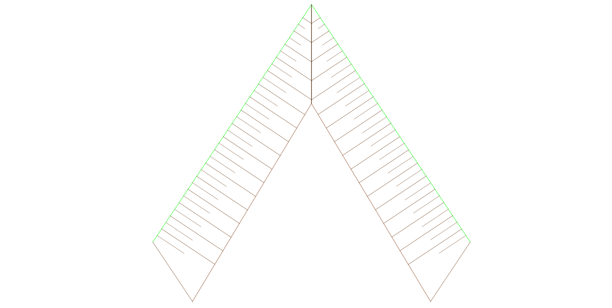
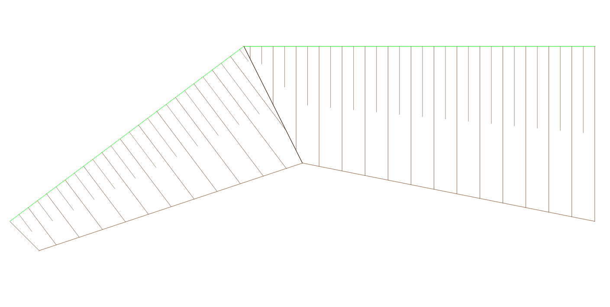
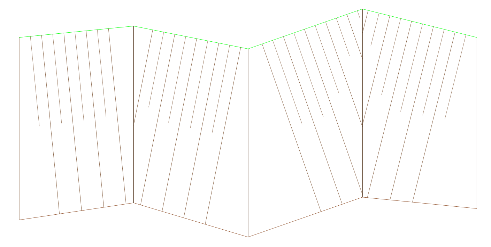
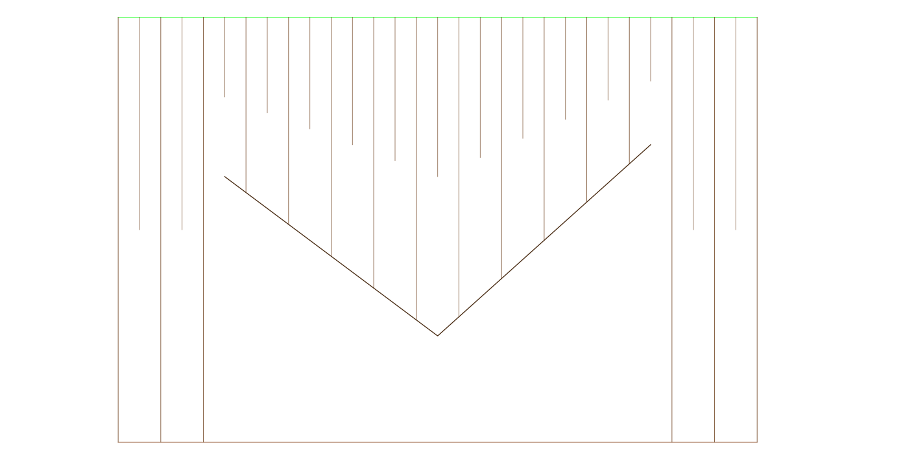
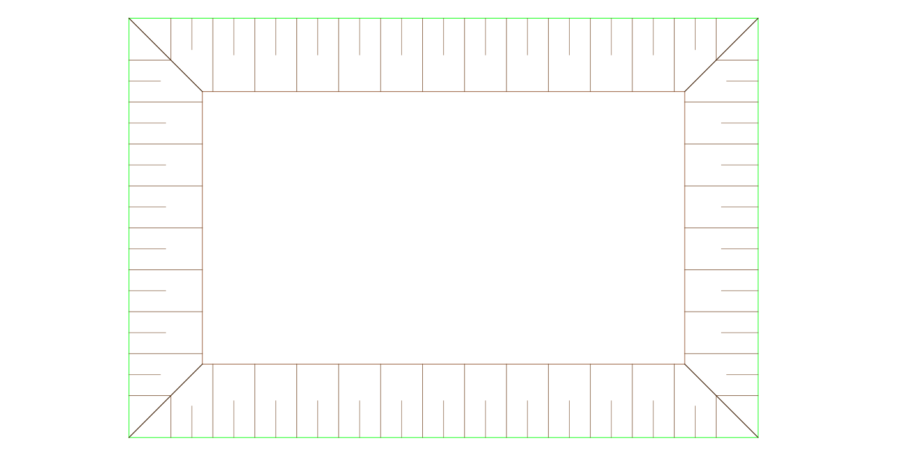

# Slope Hachures for QGIS (Böschungsschraffen)

[](https://qgis.org)
[](https://www.gnu.org/licenses/gpl-3.0)
[](https://ko-fi.com/perlde)

A QGIS Processing plugin that creates slope hachures (embankment ticks, Taludschraffur) from crest and toe lines according to **RE 2012**, **OKSTRA 0486** and **DIN 2425 / 18702**.


## Examples

| | |
|:--:|:--:|
| <br>Stress test overview | <br>Stress test 1 |
| <br>Stress test 2 | <br>Stress test 3 |
| <br>Stress test 4 | <br>Stress test 5 |

## Features

- Standard cartographic look: long and short hachures in earth brown, styled automatically.
- Breakline support (Kehlen) for excavation pits, ramps and daylight transitions (OKSTRA 0486).
- Even spacing per crest section: the spacing is adjusted per section, so no compressed hachure remains at a section end.
- Overlap reduction at sharp bends and breaklines.
- Automatic CRS transformation: crest, toe and breakline layers may use different projected CRS.
- Strict attribute grouping: a NULL group only matches a NULL group.
- Integrated into the Processing Toolbox, Graphical Modeler and Batch mode.
- German and English interface, selected automatically from the QGIS language.

## Recommended spacing by print scale

| Print scale | Typical use | Recommended interval |
| :--- | :--- | :--- |
| 1 : 250 | Site details, building pits | 1.0 – 1.5 m |
| 1 : 500 | Standard civil engineering plans | 2.0 – 3.0 m |
| 1 : 1000 | Overview plans, road design | 4.0 – 5.0 m |

## Installation

**From ZIP:** Plugins → Manage and Install Plugins → Install from ZIP → select the ZIP file.

**Manually:** Copy the folder `slope_hachures` into the QGIS plugin folder, then restart QGIS.

## Quick start

1. Use layers with a projected, metric CRS (e.g. UTM EPSG:25832).
2. Open Processing Toolbox → Terrain & Tracing → Generate Slope Hachures (OKSTRA / RE 2012).
3. Select the crest line (Kamm) and the toe line (Fuß).
4. Optional: select the breakline layer (Kehlen) for pits and corners. Where a hachure drawn perpendicular to the crest no longer meets the toe line because the toe line ends earlier, add a breakline (Randkehle) at that point.
5. Set the interval and run.

## Development

```bash
# Compile translations (requires lrelease)
cd i18n && python build_translations.py
```

Layout: `core/` contains the geometry engine without any UI or processing code. `processing/` contains the Processing algorithm, the provider and the styling. `plugin.py` is the QGIS entry point.

## License

GNU General Public License v3.0 or later. See `LICENSE`.

## Support

If this plugin saves you time on projects, you can support its maintenance: [Ko-fi](https://ko-fi.com/perlde).
