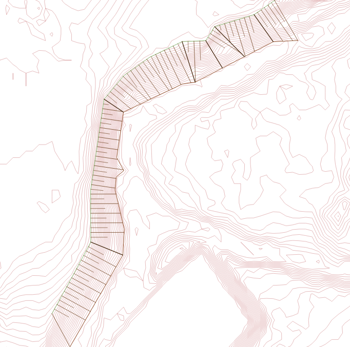
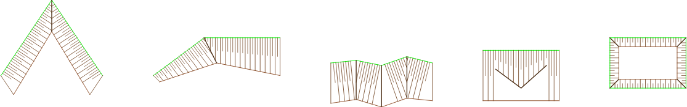

# Slope Hachures for QGIS (Böschungsschraffen)

A high-precision, professional QGIS Processing plugin for creating cartographic **slope hachures** (embankment ticks / Taludschraffur) from crest and toe lines according to civil engineering standards (**RE 2012**, **OKSTRA 0486**, **DIN 2425 / 18702**).

---

## Visual Showcase

### Natural Slope (Curved Alignment with Breaklines)

### Excavation Pit & Stress Tests (OKSTRA Breakline Support)

---

## Key Features

- **Standard Cartographic Look (1:1 Alternating Pattern):** Produces fine, clean slope ticks (earth brown `#6E411E`, 0.22 mm long / 0.18 mm short) without manual post-styling.
- **Breakline & Excavation Pit Support (OKSTRA 0486):** Supports corner diagonals (Kehlen) for excavation pits, ramps, and daylight transitions. Hatches cleanly stop at breaklines without crossing.
- **Adaptive Spacing Equalization:** Harmonizes interval steps to prevent compressed residual ticks at the end of alignments.
- **Zero-Collision Engine:** Enforces monotonicity and boundary barriers to eliminate crossovers and spiderweb clustering in sharp interior bends.
- **Full QGIS Integration:** Fully batch-capable, integrates into the QGIS Processing Toolbox, Graphical Modeler, and Python API.
- **Bilingual Interface:** Automatic German and English localization depending on your QGIS locale.

---

## Recommended Spacing by Print Scale

| Print Scale | Typical Application | Recommended Interval |
| :--- | :--- | :--- |
| **1 : 250** | Site details, building pits, foundation grading | **1.0 – 1.5 m** |
| **1 : 500** | Standard civil engineering & grading plans | **2.0 – 3.0 m** |
| **1 : 1000** | Tracing, road design, overview site plans | **4.0 – 5.0 m** |

---

## Installation

### Method A: From the Official QGIS Plugin Repository
1. In QGIS, navigate to **Plugins** → **Manage and Install Plugins...**
2. Search for **Slope Hachures** or **Böschungsschraffen**.
3. Click **Install Plugin**.

### Method B: Manual Installation via ZIP
1. Download the latest release `.zip` from this repository.
2. In QGIS, go to **Plugins** → **Manage and Install Plugins...** → **Install from ZIP**.
3. Select the `.zip` file and click **Install Plugin**.

---

## Quick Start

1. Ensure your layers are in a **projected metric CRS** (e.g., UTM EPSG:25832).
2. Click the **Slope Hachures** icon in the Vector toolbar (or open **Processing Toolbox** → **Terrain & Tracing** → **Generate Slope Hachures**).
3. Select your **Crest line (Kamm)** and **Toe line (Fuß)**.
4. *(Optional)* Select your **Valleys / Breaklines (Kehlen)** layer for complex corners or building pits.
5. Set your desired interval (e.g., `3.0 m`) and run.

---

## License

This project is licensed under the **GNU General Public License v3.0 (GPLv3)**. See the [LICENSE](LICENSE) file for details.

---

## Support & Sponsorship

If this plugin saves you billable project hours or helps your surveying office, consider supporting its maintenance:
👉 [Support on Ko-fi](https://ko-fi.com/perlde).

---
